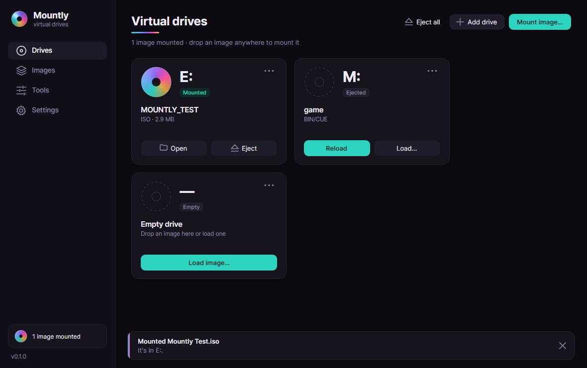
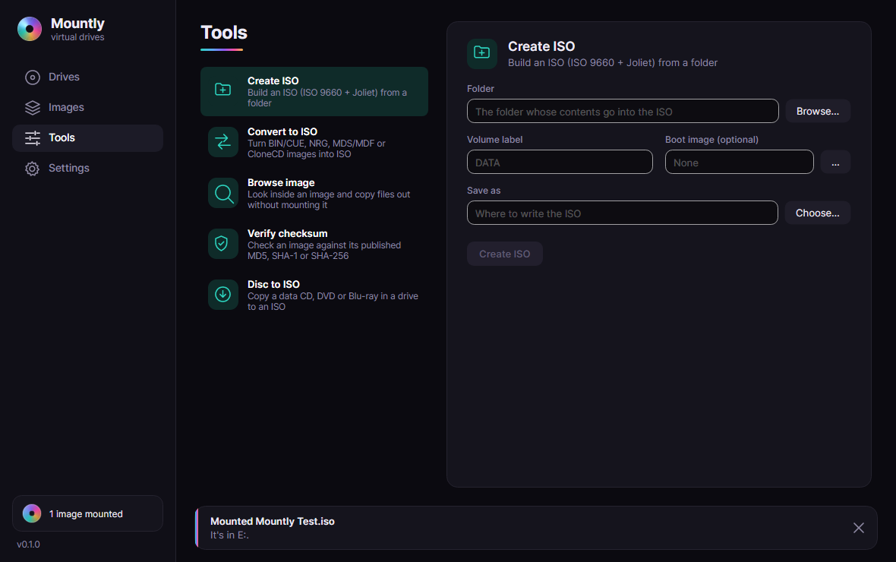
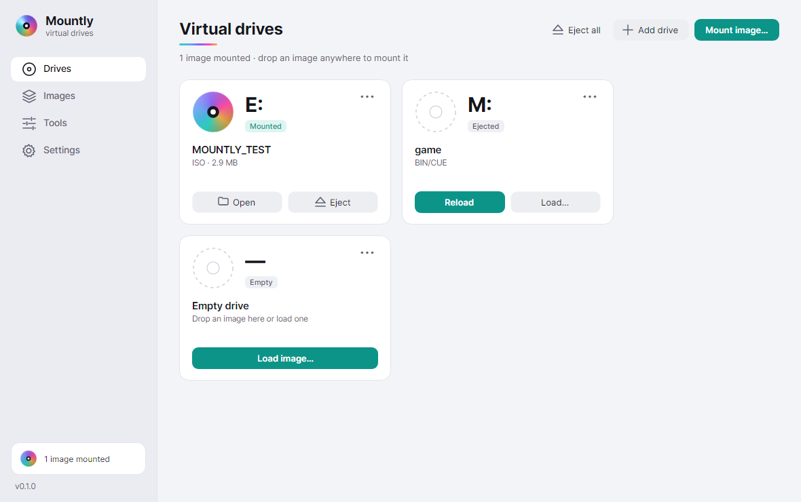

<p align="center">
  
</p>

#  Mountly

[](https://github.com/Alexxfromgit/Mountly/actions/workflows/ci.yml)
[](https://github.com/Alexxfromgit/Mountly/releases/latest)
[](LICENSE)

Virtual drives for Windows. Mountly mounts disc and disk images (ISO, VHD, VHDX, BIN/CUE, NRG,
MDS/MDF and CloneCD) as drives. It also comes with the tools that go with them: create ISOs, convert
images, browse them without mounting, verify checksums, and copy discs to ISO.

There is no kernel driver to install. Mountly uses Windows' own virtual disk support, so ISO files
mount **without administrator rights**. Formats Windows can't mount itself are converted to an ISO on
the fly and cleaned up when you eject them.

## Download

Get the latest version from [Releases](https://github.com/Alexxfromgit/Mountly/releases/latest):

| Platform | Installer | Portable |
|---|---|---|
| Windows 10/11 (x64) | `Mountly-win-x64-Setup.exe` | `Mountly-win-x64-Portable.zip` |
| Windows 11 on ARM | `Mountly-win-arm64-Setup.exe` | `Mountly-win-arm64-Portable.zip` |

The installer needs no administrator rights. Installed copies update themselves from GitHub Releases,
and you can turn that off in Settings. `SHA256SUMS.txt` on each release lists every file's checksum.
Every file also has signed build provenance; check it with `gh attestation verify <file> -R Alexxfromgit/Mountly`.
Until releases are code signed, SmartScreen asks you to confirm ("More info" → "Run anyway").

## Features

| Area | What you get |
|---|---|
| Virtual drives | Create drives, load images into them, eject and reload. A drive can keep a fixed letter (this needs administrator rights; Mountly asks once through UAC). Drives are remounted when Mountly starts, because Windows ejects every image on restart |
| Formats | **ISO**, **VHD**, **VHDX** mount natively. **BIN/CUE** (Mode 1/Mode 2, 2048/2336/2352/2448-byte sectors), **NRG** (Nero v1/v2, DAO/TAO), **MDS/MDF** (Alcohol 120%), **CCD/IMG** (CloneCD) and raw **BIN/IMG** data tracks mount through an ISO converted on the fly |
| Everywhere | Drag images onto the window. A tray menu lists mounted drives and ejects them. Optional Explorer entries add “Mount with Mountly”, “Convert to ISO” and “Verify checksum” on image files, “Create ISO with Mountly” on folders, and Mountly in each image type's “Open with” list. They never change your default app for `.iso` |
| Tools | **Create ISO** from a folder (ISO 9660 + Joliet, optional El Torito boot image). **Convert** to ISO. **Browse** an image's files and extract them without mounting. **Verify** MD5/SHA-1/SHA-256 against a value or a `SHA256SUMS` file. **Disc to ISO** copies a data CD/DVD/BD, retrying unreadable sectors |
| CLI | `mountly-cli` does all of the above from scripts. Run `mountly-cli --help` |
| Look | Light and dark themes following Windows, with the spinning iridescent disc as a busy indicator |

<p align="center">
  
  
</p>

### Command line

```powershell
mountly-cli mount game.cue                  # converts, then mounts; prints the drive letter
mountly-cli mount ubuntu.iso --letter U     # a fixed letter needs an elevated prompt
mountly-cli list --json
mountly-cli unmount E:                      # or: unmount game.cue, unmount --all
mountly-cli create .\folder backup.iso --label BACKUP
mountly-cli convert game.nrg game.iso
mountly-cli ls game.mds -r
mountly-cli extract game.cue "/" .\out
mountly-cli verify ubuntu.iso SHA256SUMS    # exit code 4 on a mismatch
mountly-cli rip D: disc.iso
```

Exit codes: `0` ok, `1` error, `2` usage, `3` needs administrator rights, `4` checksum mismatch.

## How it works

```
src/
  Mountly.Core      Image formats, MountService (native or convert-then-mount), settings, drives, catalog
  Mountly.Formats   CUE/BIN, NRG, MDS/MDF, CloneCD and raw-track readers; ISO converter
  Mountly.Tools     ISO builder, image browser/extractor, checksums (DiscUtils)
  Mountly.Windows   Mount backend (Windows Storage provider, MSFT_DiskImage), drive letters,
                    disc ripping, Explorer integration, elevated CLI runner
  Mountly.Cli       mountly-cli
  Mountly.App       Avalonia 12 desktop app (MVVM, tray, single instance, Velopack updates)
tests/
  Mountly.Tests           Format readers against images synthesised at test time, tools, MountService
  Mountly.Windows.Tests   Real mounts: ISO, BIN/CUE through conversion, rip of the mounted drive
```

Mounting goes through `MSFT_DiskImage`, the same provider Explorer's "Mount" and `Mount-DiskImage`
use. Mounts belong to Windows, not to Mountly, so they stay mounted when Mountly closes. Every format
reader turns its image into the 2048-byte user data of the first data track. That same stream feeds
conversion, browsing and, later, direct mounting through a virtual SCSI driver.
See [docs/ARCHITECTURE.md](docs/ARCHITECTURE.md).

## Roadmap

- Mount every format directly, with no conversion, through [Arsenal Image Mounter](https://github.com/ArsenalRecon/Arsenal-Image-Mounter)'s
  signed driver (AGPLv3, compatible with Mountly's GPLv3), and an optional service for elevated operations.
- Windows 11's top-level context menu (`IExplorerCommand` with a sparse package).
- Linux (`udisksctl loop-setup`) and macOS (`hdiutil`) backends. The core libraries already build and test on Linux in CI.

## Building

You need the .NET 10 SDK (`global.json` pins it) on Windows 10/11.

```powershell
./build.ps1 -Test              # build, unit tests, real-mount integration tests
dotnet run --project src/Mountly.App
./build.ps1 -Pack              # installer, portable zip and update packages in artifacts/releases
```

See [CONTRIBUTING.md](CONTRIBUTING.md) for pull requests and [docs/RELEASING.md](docs/RELEASING.md) for releases.

## License

[GNU General Public License v3.0 or later](LICENSE). Third-party components are listed in
[THIRD_PARTY_NOTICES.md](THIRD_PARTY_NOTICES.md).
